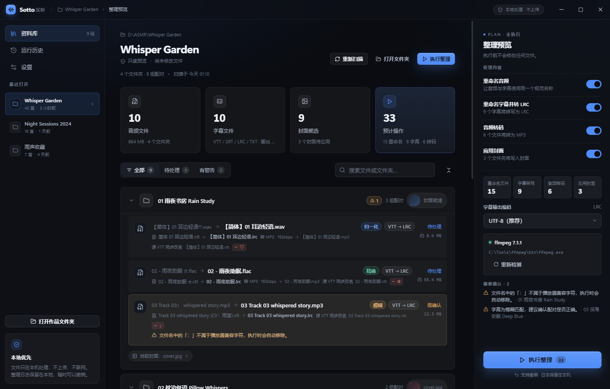
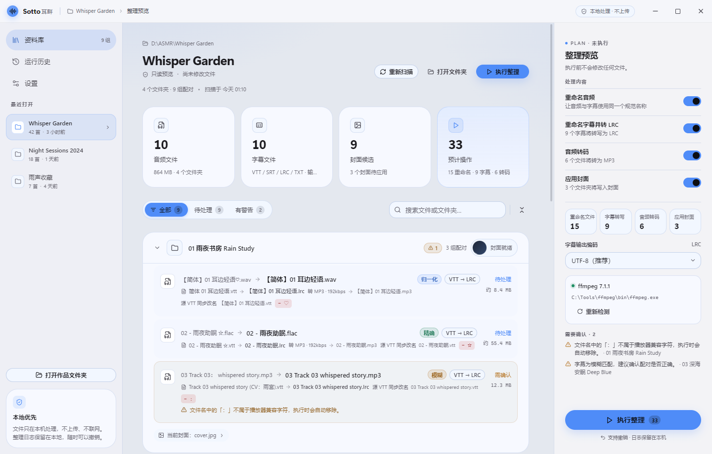
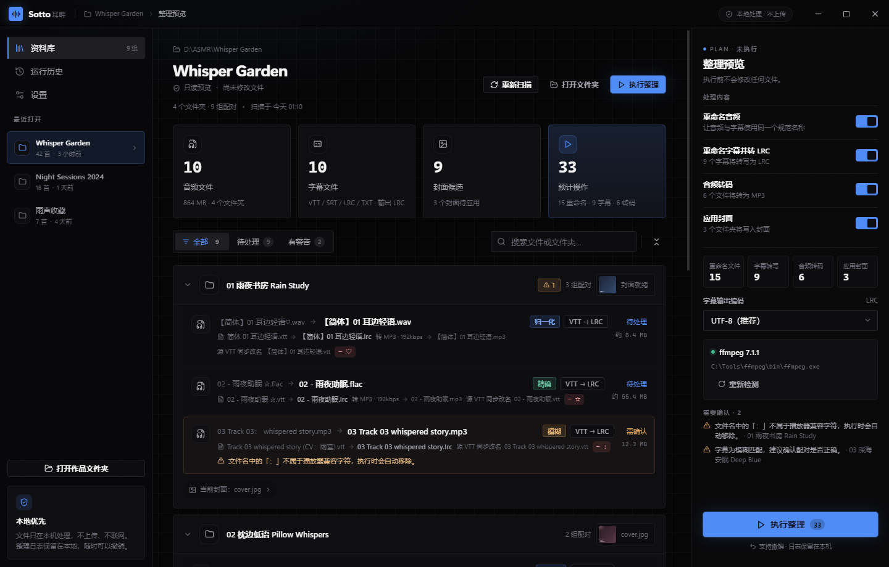
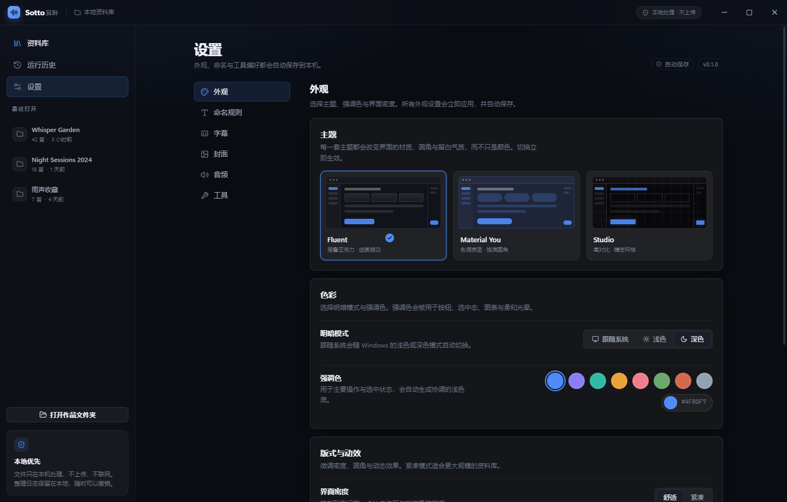

# 界面设计说明

## 设计目标

Sotto 是一个“整理工具”，但使用场景很安静：用户往往在深夜整理收藏。界面应该像一间收拾干净的房间——信息密度足够，但不吵。

三个关键词：

1. **可信**：即将改名的文件、将被删除的原文件、可能覆盖的 LRC，必须在执行前一眼看清。
2. **安静**：低饱和背景、克制的强调色、有限的动效；不使用游戏化霓虹和过度玻璃拟态。
3. **可塑**：同一套信息架构承载三种审美，用户可以用强调色、圆角、密度、字号把它变成自己的工具。

## 三套可行方向（已全部实现）

### 1. Fluent / UWP（默认，推荐）

灵感：Windows 11 设置、Files、Microsoft Store。

- 半透明的分层表面、1px 亮边、轻微背景光晕；
- 10px 圆角，Segoe UI Variable + 微软雅黑 UI；
- 侧栏与内容区之间用层次而非粗分割线；
- 主按钮使用强调色实底，次按钮为透明的“描边 + 悬停填充”；
- 适合大多数 Windows 用户，和系统观感一致。

### 2. Material You

灵感：Google Files、Material 3。

- 以强调色通过 `color-mix` 生成 tonal surface（容器色），卡片更圆（20–24px）；
- 更强的留白与更大的点击区域，主按钮为胶囊形；
- 信息分组更像“卡片流”，弱化描边，强调层级与色块；
- 适合喜欢 Google 风格、屏幕较大或触控设备的用户。

### 3. Studio

灵感：Linear、Raycast、专业音频工具。

- 近黑底、高对比文字、8px 小圆角；
- 数字与文件名使用等宽字体，信息密度最高；
- 强调色只出现在焦点、进度和关键操作上，带一点冷光晕；
- 适合重度用户与大曲库。

### 推荐

默认 **Fluent**：它与 Windows 的窗口、字体、交互习惯最一致，也最容易让第一次使用的用户建立信任。喜欢更“Google”的观感可以切到 Material You；需要长时间批量处理时切到 Studio。

## 信息架构

```text
标题栏（拖拽区 + 窗口控制）
├─ 侧栏
│  ├─ 资料库（空状态 / 工作台）
│  ├─ 运行历史
│  ├─ 设置
│  └─ 最近打开 + 本地优先提示
└─ 主区域
   ├─ 资料库：Hero、拖放区、最近项目、功能说明
   ├─ 工作台：统计卡 → 文件夹手风琴（配对/改名/警告/封面）→ 右侧方案栏
   ├─ 历史：运行记录 + 撤销
   └─ 设置：外观 / 命名 / 字幕 / 音频 / 工具
浮层：封面选择器、执行进度、结果、Toast
```

工作台的核心是“**先看方案，再执行**”。每一条配对都展示：

- 旧音频名 → 新音频名；
- 字幕来源、匹配方式（精确/归一化/模糊/单文件/手动）；
- 将被删除的特殊字符（逐个 chip）；
- 是否转 LRC、输出编码、是否覆盖已有 LRC；
- 音频转码格式与目标文件名；
- 警告（低置信度、同名冲突、无字幕、ffmpeg 不可用等）。

右侧方案栏负责“这次到底做什么”，用开关控制重命名、字幕转换、转码、封面四个动作，并显示操作计数与警告汇总。

## 设计令牌

| 令牌 | 说明 |
| --- | --- |
| `--bg` / `--bg-elevated` | 应用底色与浮层底色 |
| `--surface` / `--surface-hover` | 卡片、行、按钮表面 |
| `--stroke` | 描边（Fluent 以亮边为主） |
| `--text` / `--text-2` / `--text-3` | 三级文字 |
| `--accent` / `--accent-strong` | 强调色与悬停色 |
| `--radius` | 由用户滑杆控制（4–20px） |
| `--font-scale` | 90%–115% 字号缩放 |
| `--shadow-1/2` | 主题专属阴影 |

强调色的浅色 tint 使用 `color-mix(in srgb, var(--accent) 12%, transparent)`，保证任意自定义色都不会脏。

## 动效与可达性

- 页面切换 180ms；手风琴 160ms；按钮 120ms；`prefers-reduced-motion` 或设置项开启时降级为 0ms。
- 所有图标按钮有 `aria-label` 与 `title`；焦点环使用强调色 2px。
- 文件名中间省略，悬停显示完整路径；长路径可复制。
- 弹窗支持 Esc 关闭、点击遮罩关闭；危险操作（删除原文件）在设置中明确标注。

## 截图

截图由 `npm run screenshots` 生成，使用内置演示数据，不依赖真实曲库。见 `docs/screenshots/`。

### Fluent（默认）



### Material You



### Studio



### 外观设置

